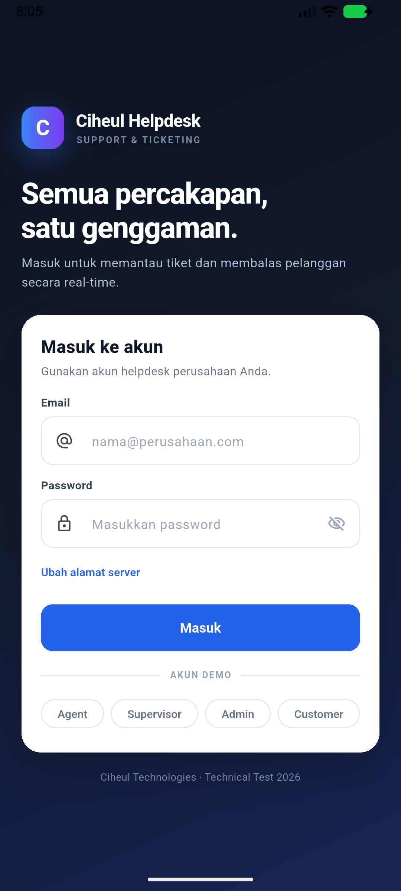
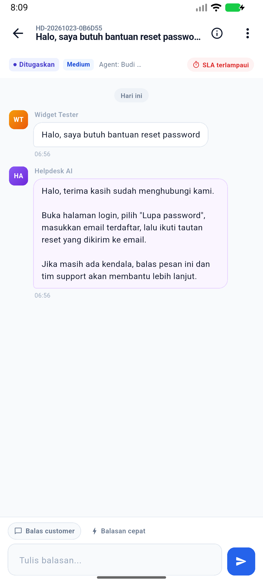
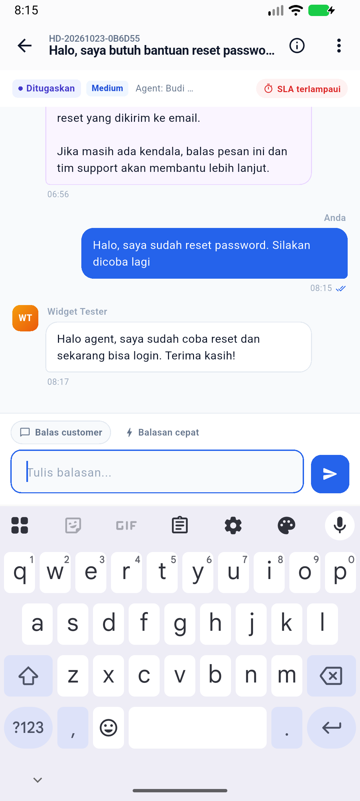

# Ciheul Helpdesk

Aplikasi helpdesk end-to-end untuk Technical Test Software Engineer **Ciheul Technologies**.
Satu tiket, satu percakapan — dapat dilanjutkan dari **live chat widget**, **web app agent**, dan
**mobile app** tanpa kehilangan riwayat.

| Deliverable | Lokasi |
|---|---|
| BPMN proses bisnis | [`docs/BPMN-Helpdesk.pdf`](docs/BPMN-Helpdesk.pdf) |
| WBS & estimasi | [`docs/WBS-Helpdesk.xlsx`](docs/WBS-Helpdesk.xlsx) |
| Analisis & desain | [`docs/ANALISIS.md`](docs/ANALISIS.md) |
| Aplikasi web + widget | folder [`web/`](web) & [`widget/`](widget) |
| Backend REST + Socket.IO | folder [`server/`](server) |
| Mobile app (Flutter) | folder [`mobile/`](mobile) |
| APK release | [`artifacts/helpdesk.apk`](artifacts/helpdesk.apk) |

> Repository: <https://github.com/Fanadillah/ciheul-helpdesk>

---

## 1. Demo cepat

Prasyarat: **Node.js ≥ 20** (dites di Node 22). Tidak perlu build step untuk web/widget.

```bash
cd server
npm install
npm run seed          # data demo (opsional; server auto-seed saat DB kosong)
npm start
```

Buka:

| Halaman | URL |
|---|---|
| Web app (agent / supervisor / admin / customer) | <http://localhost:3000/> |
| Demo widget | <http://localhost:3000/widget/demo.html> |
| Health check | <http://localhost:3000/health> |

### Akun demo

| Role | Email | Password |
|---|---|---|
| Admin | `admin@helpdesk.test` | `Admin123!` |
| Supervisor | `supervisor@helpdesk.test` | `Super123!` |
| Agent | `agent@helpdesk.test` | `Agent123!` |
| Agent 2 | `agent2@helpdesk.test` | `Agent123!` |
| Customer | `customer@helpdesk.test` | `Cust123!` |

Widget memakai pre-chat (nama + email) dan membuat sesi **guest** otomatis; tidak perlu password.
Gunakan email baru setiap kali ingin membuat sesi guest baru.

### Skenario demo lintas kanal

1. Buka `widget/demo.html`, isi nama + email, kirim pesan. Tiket baru muncul **realtime** di inbox web
   (login `agent@helpdesk.test`).
2. Balas dari web. Balasan muncul di widget tanpa refresh.
3. Login ke mobile app dengan akun customer yang sama (atau agent), buka tiket, lanjutkan percakapan.
4. Ubah status tiket menjadi **Resolved** dari web; customer dapat memberi **CSAT** di widget/mobile.
5. Matikan server sebentar → widget/mobile menunjukkan status offline, pesan masuk antrean lokal, lalu
   terkirim otomatis saat koneksi kembali (idempotent, tidak dobel).

---

## 2. Arsitektur

```
┌──────────────────────┐      ┌──────────────────────┐      ┌──────────────────────┐
│  Widget (vanilla JS) │      │  Web app (vanilla JS)│      │  Mobile (Flutter)    │
│  Shadow DOM, guest   │      │  agent/supervisor/   │      │  customer & agent    │
│  session, queue      │      │  admin/customer      │      │  local notification  │
└──────────┬───────────┘      └──────────┬───────────┘      └──────────┬───────────┘
           │ REST + Socket.IO            │ REST + Socket.IO            │ REST + Socket.IO
           └─────────────────────────────┼─────────────────────────────┘
                                         ▼
                         ┌────────────────────────────────┐
                         │ Node.js + Express + Socket.IO  │
                         │ JWT auth · RBAC · rate limit   │
                         │ AI reply (optional) + KB       │
                         └───────────────┬────────────────┘
                                         ▼
                         ┌────────────────────────────────┐
                         │ SQLite (WAL) + file uploads    │
                         │ tickets, messages, SLA, audit  │
                         └────────────────────────────────┘
```

**Satu origin** untuk web + widget, sehingga tidak ada masalah CORS pada demo. Mobile memakai
REST untuk aksi dan Socket.IO untuk menerima event; jika socket terputus, REST + polling/refresh
tetap bekerja.

### Struktur repository

```
.
├── artifacts/            # APK release (helpdesk.apk)
├── docs/                 # BPMN, WBS, analisis, generator
├── mobile/               # Flutter app (Android + Windows)
│   └── lib/
│       ├── core/         # api client, socket, state, model, notifikasi
│       ├── screens/      # login, inbox, detail, buat tiket, notifikasi, setting
│       └── widgets/      # komponen UI bersama
├── server/
│   ├── src/
│   │   ├── db/           # schema.sql, seed, migrasi
│   │   ├── middleware/   # JWT auth, RBAC
│   │   ├── realtime/     # Socket.IO contract
│   │   ├── routes/       # REST endpoints
│   │   └── services/     # tiket, pesan, SLA, AI, laporan
│   └── tests/            # Vitest + Supertest + socket.io-client
├── web/                  # SPA tanpa build step (ES modules)
└── widget/               # chat-widget.js + demo.html
```

---

## 3. Fitur

### Widget (customer)
- Bubble mengambang + panel chat, **Shadow DOM** agar CSS host tidak bentrok.
- Pre-chat (nama, email), sesi guest JWT, persistensi `localStorage`.
- Chat realtime, indikator typing, status koneksi, unread badge.
- **Offline queue**: pesan disimpan dan dikirim ulang otomatis setelah reconnect.
- CSAT bintang setelah tiket resolved, tombol reopen, penanganan tiket closed.
- Lampiran (upload via REST) dan fallback polling bila Socket.IO gagal.

### Web app
- Login multi-role dengan guard dan redirect sesuai role.
- Inbox split-view: filter status/prioritas/assignee, pencarian, badge unread, notifikasi browser.
- Detail tiket: chat realtime, **catatan internal** (tidak terlihat customer), lampiran,
  canned response, **balasan AI**, ubah status/prioritas/assignee.
- Customer portal: buat tiket, daftar tiket sendiri, CSAT, reopen.
- Dashboard supervisor: KPI (volume, first response, resolusi, SLA compliance, CSAT),
  grafik volume/kanal, beban agent, tiket CSAT rendah.
- Admin: kelola user & role, kategori + kebijakan SLA, knowledge base untuk AI.
- Fallback polling + tombol resync saat socket terputus.

### Mobile (Flutter)
- Login customer/agent/supervisor/admin, simpan sesi aman di `shared_preferences`.
- Daftar tiket dengan filter, pencarian, pull-to-refresh, badge unread.
- Detail chat realtime, optimistic UI, status pengiriman, retry antrean offline.
- Buat tiket baru, CSAT, reopen, ubah status/assignee (staff), balasan AI.
- **Local notification** (`flutter_local_notifications`) untuk pesan/notifikasi baru.
- Pengaturan alamat server (emulator vs perangkat fisik) dan status koneksi.

### Backend
- REST + Socket.IO, JWT (12 jam), password **bcrypt**, RBAC di REST & event socket.
- Siklus tiket dengan validasi transisi status, SLA first response/resolution, audit events.
- **Idempotensi pesan** lewat `client_message_id` (REST & socket) → retry tidak menggandakan pesan.
- AI auto-reply saat tiket dibuat (opsional) + fallback knowledge base tanpa API key.
- Rate limit login/guest session, validasi input, batas ukuran & tipe lampiran.
- Seed data demo; server tidak menghapus data saat restart.

---

## 4. Selalu terhubung (reliability)

| Skenario | Perilaku |
|---|---|
| Socket tersambung | Pesan & update tiket dikirim seketika melalui room `ticket:{id}` |
| Socket putus | Widget/mobile/web memakai REST; UI menampilkan status offline |
| Pesan gagal terkirim | Disimpan di antrean lokal (`localStorage` / `shared_preferences`) |
| Reconnect | Antrean dikirim ulang dengan `client_message_id` yang sama; server mengembalikan pesan lama (`duplicate: true`) |
| Event terlewat | `ticket:join {last_seq}` mengembalikan pesan setelah seq terakhir; refresh/polling sebagai jaring kedua |
| Multi-kanal | Widget, web, dan mobile join room tiket yang sama — semua menerima pesan tanpa duplikasi |

---

## 5. API singkat

Semua endpoint privat memakai header `Authorization: Bearer <token>`.

| Method | Endpoint | Keterangan |
|---|---|---|
| `POST` | `/api/auth/login` | Login staff/customer |
| `GET` | `/api/auth/me` | Profil token aktif |
| `GET` | `/api/public/categories` | Kategori untuk widget |
| `POST` | `/api/public/session` | Sesi guest widget |
| `GET/POST` | `/api/tickets` | Daftar / buat tiket |
| `GET/PATCH` | `/api/tickets/:id` | Detail / ubah status, prioritas, assignee |
| `GET/POST` | `/api/tickets/:id/messages` | Riwayat / kirim pesan (mendukung `client_message_id`, `is_internal`) |
| `POST` | `/api/tickets/:id/attachments` | Upload lampiran (maks 5 MB) |
| `POST` | `/api/tickets/:id/csat` | Rating customer |
| `POST` | `/api/tickets/:id/reopen` | Reopen ≤ 7 hari |
| `POST` | `/api/tickets/:id/ai-reply` | Generate balasan AI (staff) |
| `GET` | `/api/reports/summary` | KPI supervisor/admin |
| `GET/POST/PATCH` | `/api/users`, `/api/categories`, `/api/kb` | Admin |

### Socket.IO

Auth: `io(url, { auth: { token } })`.

| Arah | Event | Payload |
|---|---|---|
| client → server | `ticket:join` | `{ticket_id, last_seq}` → ack `{ok,ticket,messages}` |
| client → server | `message:send` | `{ticket_id, body, client_message_id, is_internal}` → ack `{ok,duplicate,message_id,seq}` |
| client → server | `typing` / `message:read` | `{ticket_id, is_typing}` / `{ticket_id, message_id}` |
| server → client | `message:new`, `ticket:update`, `ticket:created` | objek pesan/tiket |
| server → client | `notification:new`, `sla:breach`, `presence:update` | objek notifikasi/event |

---

## 6. Mobile app

### Jalankan langsung

```bash
cd mobile
flutter pub get
flutter run --dart-define=API_BASE=http://10.0.2.2:3000
```

- **Emulator Android**: default `http://10.0.2.2:3000` (host machine).
- **Perangkat fisik**: gunakan IP LAN komputer, mis. `--dart-define=API_BASE=http://192.168.1.10:3000`,
  atau ubah lewat tautan **Ubah alamat server** di halaman login / menu Pengaturan.
- **Windows desktop**: `flutter run -d windows --dart-define=API_BASE=http://localhost:3000`.

### Build APK

```bash
cd mobile
flutter build apk --release --dart-define=API_BASE=http://10.0.2.2:3000
# hasil: build/app/outputs/flutter-apk/app-release.apk
```

APK yang disertakan di repo dibangun dengan base URL default emulator. Alamat server tetap dapat
diganti dari dalam aplikasi tanpa rebuild. Izinkan notifikasi saat diminta (Android 13+).

### Catatan
- Notifikasi yang dipakai adalah **local notification** (bonus), dipicu event Socket.IO; belum
  memakai FCM sehingga tidak menerima notifikasi saat aplikasi benar-benar dimatikan.
- APK ditandatangani dengan debug key agar dapat langsung dipasang untuk demo.
- Lampiran di mobile ditampilkan sebagai nama file; upload/download penuh tersedia di web/widget.

### Tampilan

<p align="center">
  
  
  
</p>

---

## 7. AI auto-reply (opsional)

Tanpa konfigurasi, sistem memakai **fallback knowledge base** (keyword match) sehingga demo tetap
jalan offline. Untuk memakai model OpenAI-compatible:

```bash
cd server
copy .env.example .env
# isi AI_API_KEY, AI_BASE_URL, AI_MODEL
npm start
```

Variabel penting: `AI_AUTO_REPLY=false` untuk mematikan auto-reply, `AI_API_KEY` kosong untuk
fallback KB. AI hanya membuat balasan awal dan **tidak** menutup tiket.

---

## 8. Testing

```bash
# backend: REST lifecycle + RBAC + socket contract/idempotensi
cd server
npm test

# mobile: model, formatter, widget smoke test
cd mobile
flutter analyze
flutter test
```

Hasil terakhir: **6 test backend lulus**, **4 test Flutter lulus**, `flutter analyze` tanpa issue,
APK release berhasil dibangun (±48 MB).

QA manual yang sudah dijalankan: login semua role, kirim pesan web↔widget realtime, tiket widget
muncul di inbox agent, laporan supervisor, admin CRUD, CSAT, dan pengecekan UI headless
(Chrome + Puppeteer). Detail skenario dan hasilnya ada di [`docs/QA.md`](docs/QA.md).

---

## 9. Keputusan teknis

- **SQLite + `better-sqlite3`** — nol konfigurasi, transaksi sinkron, cocok untuk demo single-node.
- **Vanilla JS untuk web/widget** — memenuhi syarat "JavaScript" tanpa build tool; lebih mudah
  dijalankan fresh clone.
- **REST untuk aksi, Socket.IO untuk event** — aksi tetap berhasil saat socket bermasalah; socket
  mempercepat sinkronisasi. Idempotensi membuat retry aman.
- **JWT + bcrypt + RBAC berlapis** — pembatasan diterapkan di route dan socket, bukan hanya UI.
- **Flutter** — satu basis kode Android/Windows, `socket_io_client` kompatibel dengan server.

## 10. Batasan & pengembangan lanjut

- SQLite belum cocok untuk multi-instance; produksi dapat memakai PostgreSQL + Redis adapter.
- Notifikasi mobile bersifat lokal; FCM dapat ditambahkan untuk background push.
- Belum ada SLA pause saat status Pending, dan auto-close terjadwal masih manual/berkala.
- Belum ada enkripsi end-to-end atau SSO; token disimpan di storage lokal perangkat.
- Seed memakai password demo — **jangan** dipakai di produksi.

---

Dibuat oleh **Fanadillah** untuk Technical Test Software Engineer, Ciheul Technologies — Oktober 2026.
